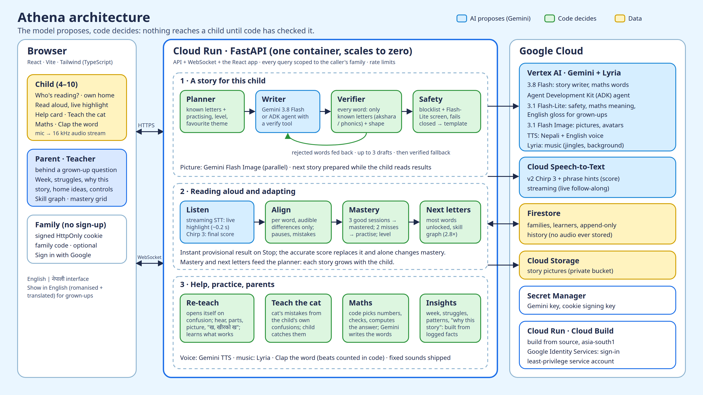

# Athena

**A reading friend that writes stories for one child.** For children aged 4–10 learning to read,
starting with Nepali and English.

Athena finds out exactly which letters, vowel signs and sounds a child can read, then writes a
short illustrated story about the things they love (their favourite animal, food, game) using
**only** those letters. The child reads it aloud, Athena follows each word, helps where they get
stuck, and the next story grows with them.

> **Model proposes, code decides.** Gemini writes; a deterministic verifier checks every word.
> In 300 evaluation stories, **0 words a child could not read** reached a child.

**Live demo: https://athena-ybi3v6o5la-el.a.run.app** (Chrome recommended, allow the microphone)

---

## Try it in 3 minutes

1. Open the demo, press **Start**, then **Continue without an account**, then **Skip, try demo**.
   You get your own private copies of three demo children, each with a sample week of progress.
2. Tap **Leo** → **English**. Press the microphone and read the story aloud: words light up as you
   read, and turn green the moment you stop. Tap any word for help ("t for tent, a for apple").
3. Tap **Sita** → **नेपाली**. Every word uses only letters Sita knows. Press **Show in English**
   under the story to read it (romanised + translated).
4. On a child's page try **Teach the cat** (the cat reads with mistakes and you catch them) and
   **Clap the word** (tap the drum once for each part of a word, with music).
5. Open **For grown-ups** (type the number words as digits), then a **Parent view**: the week,
   what is hard, why each story was written, ideas for home, time and content controls.

The interface is in English by default; switch to नेपाली at the top of the page.

---

## The problem

Every child who struggles to read struggles in a specific way. In Nepal, children learn to decode
two scripts at once, Nepali (Devanagari: 36 consonants, 12 vowel signs, hundreds of conjuncts)
and English, from fixed books that cannot match what each child can already read. A book with one
unknown letter on every page is a book the child cannot read alone.

Reading apps choose a book for the child from a fixed library. **Athena writes one**: for this
child, today, with exactly their letters, and proves it fits before showing it.

## What it does: the whole learning loop

| Step | In Athena |
|---|---|
| **Assess** | A 2-minute, game-like letter check ("Help the bird cross the river!"): listen-and-tap cards, stops early when it has enough. Places the child's known letters and story level. |
| **Profile** | Letters mastered and practising, story level, maths level, pace (words per minute), mistake patterns (e.g. breathy vs plain letters घ/ग), what re-teaching works for this child, interests. |
| **Adaptive lessons** | Stories written for the child's letters, about their favourite animal/food/game. The child picks one of three. Story size follows their level. Maths word problems they can read. |
| **Detect confusion, re-teach differently** | Live follow-along notices long pauses and repeated mistakes on one letter, then opens a help card on its own: hear it, see its parts, see a picture, tie the letter to a known word ("ख, खीरको ख"). It learns which way works best for each child. Never says "wrong". |
| **Teach the cat** | A child-sized Feynman technique: the cat reads with mistakes chosen from this child's own confusions, and the child catches them. |
| **Clap the word, with music** | Phonological awareness through rhythm: the child taps once for each part of a word (सी·ता, rab·bit), over a soft music bed. The first word shows itself first. Beats are counted in code. Music by Lyria, made once and shipped. |
| **Mastery over time** | A letter is mastered after three good sessions and goes back to practice after two misses. New letters come in the order that unlocks the most new words (2.8× more readable words at 40 letters than the textbook order), respecting a skill graph (a conjunct needs both its letters). |
| **Parents** | This week, letters learned, struggle alerts, mistake patterns, why each story was written, home activities, daily time limit, content controls, every story and reading reviewable. |
| **Safe and motivating** | Every story screened for child safety; first name only; no audio kept; stars and a daily goal, no streak pressure; private families; a grown-up question in front of grown-up pages. |

## Guarantees: what code decides, not the model

- **Readable, always.** Nepali words are decomposed into aksharas (letter + vowel sign + marks,
  conjuncts); English words are checked against a phonics lexicon of grapheme spellings. Any word
  with a unit the child has not learned is rejected and fed back to the writer (up to 3 drafts),
  then verified fallbacks (keep the good sentences, verified templates). The final check is an
  assertion: a story with an unreadable word cannot be shown.
- **Story shape.** Sentence count, words per sentence and word length per level, enforced like letters.
- **Maths is computed, not generated.** Code picks the numbers (answers spread evenly), checks
  the problem is readable, uses exactly those numbers, asks a question, and computes the answer.
  A separate check confirms the story adds or takes away as it should.
- **Child safety before display.** A blocklist plus a Gemini Flash-Lite screen that fails closed;
  an unsafe story is replaced with a verified template.
- **Reading is scored on what you can hear.** Speech-to-text output is aligned to the story; only
  audible differences count (Nepali vowel length and श/ष/स sound alike and are not penalised).
- **Explanations from data.** "Why this story", mistake patterns and progress are built in code
  from logged facts, never invented by a model.

## Measured

| | Nepali | English |
|---|---|---|
| Stories generated in evaluation | 150 | 150 |
| **Unreadable words shipped** | **0** | **0** |
| Clean on the first draft (latest run) | 32% | 68% |
| Rescued by a verified fallback | 34% | 4% |
| Median time to a verified story | 5.7 s | 2.8 s |
| Text cost per story (incl. retries) | $0.003 | $0.001 |
| Live follow-along delay after a word | 0.1 s | 0.3 s |

- Results: `eval/results/20261017-191030`, `20261017-195125`, `20261018-112925` (`.summary.json`), each `EVAL SUCCESS`.
- **Coverage:** choosing new letters by unlock value + skill graph: 209 readable Nepali words at 40
  letters vs 75 in textbook order (2.8×). `eval/results/coverage_ne.csv`, `coverage_en.csv`.
- **Maths:** 60 generated problems, 0 shipped failing a check; Nepali first-draft pass 50% → 70%
  after adding name, gender and plural rules (`eval/results/maths-*.summary.json`).
- **Cost:** about $0.07 per illustrated story, 95% of it the picture; word pictures and voice are
  cached and shared by all children.
- **Native-speaker review** of generated Nepali (honorifics, gender agreement, idiom) and the fixes
  it led to: [eval/human_review.md](eval/human_review.md).
- 182 automated tests (`pytest`), including a strict fake Firestore.

## Built on Google Cloud and Gemini

| Need | Service |
|---|---|
| Story writer | **Gemini 3.8 Flash** on **Vertex AI** (structured output, low thinking) |
| Agent mode | **Agent Development Kit (ADK)**: an agent that must pass a `verify_story` tool, used for background stories (fewer fallbacks, time hidden) |
| Safety screen, maths meaning check, English gloss | **Gemini 3.1 Flash-Lite** |
| Illustrations, word pictures, avatars | **Gemini 3.1 Flash Image** |
| Voice (Nepali has no Cloud TTS voice) | **Gemini TTS**, language-coded (`ne-NP`, `en-US`) |
| Music (jingles, background beds) | **Lyria** on Vertex AI, generated once and shipped |
| Scoring a reading | **Cloud Speech-to-Text v2, Chirp 3** with phrase hints |
| Live follow-along | **Cloud Speech-to-Text** streaming over a WebSocket |
| Hosting | **Cloud Run** (API, WebSocket and the React app in one container), scales to zero |
| Learners and history | **Firestore** |
| Story pictures | **Cloud Storage** (private, served through the API) |
| Secrets | **Secret Manager** (Gemini key, cookie signing key) |
| Sign-in (optional) | **Google Identity Services** |



Source: [docs/architecture.svg](docs/architecture.svg).

## Safety and privacy

- First name only; every profile answer is a fixed choice (favourite animal, food, game, a general
  setting, never an exact place). Free text never reaches a model prompt.
- **No audio is ever stored.** Recordings are scored in memory and dropped; only the transcript of
  a known story is kept, so a parent can review it.
- **Private families.** Each browser gets its own family (a signed, HttpOnly cookie); the server
  only returns that family's children, so one family can never see another's. A family code or
  Google sign-in opens the same family on another device. Deleting a child deletes their history.
- **Grown-up question** (type number words as digits) in front of parent and teacher pages.
- Rate limits on every model-backed endpoint; children's data, keys and caches are never in git or
  the container image.
- Parents control daily time, maths, "Teach the cat", story pictures and themes to avoid.

## Limitations (honest)

- Nepali stories rely on a seed vocabulary plus the verifier; very early learners (under ~15
  readable words) get letter practice instead of a story.
- English is checked at the spelling level (one "ow" for cow and snow).
- Reading-aloud scoring with real children's voices needs a pilot study; speech hints can hide a
  real mistake (we drop hints when re-trying a single word).
- Image generation is quota-limited; a missing picture never blocks a story.

---

## Developer guide

### Quick start

```bash
# 1. Python backend
python3 -m venv .venv
.venv/bin/pip install -e '.[dev]' -c constraints.txt
cp .env.example .env          # then fill it in, see "Configuration"

# 2. Frontend (Node 22)
cd frontend && npm install && cd ..

# 3. Run (two terminals)
.venv/bin/uvicorn athena.api:app --port 8077 --reload
cd frontend && npm run dev
```

Open **http://localhost:3000**.

| Tool | Version | Notes |
|---|---|---|
| Python | 3.12+ | `constraints.txt` pins the versions the tests pass with |
| Node | 22+ | Vite 8 needs ≥ 20.19 |
| gcloud CLI | any | For Speech-to-Text, Firestore, Cloud Storage and deploy |
| ffmpeg | any | Long recordings, picture resizing |

### Configuration

All settings come from `.env` (read by `athena/config.py`). Never commit `.env`; it is git-ignored.

| Variable | Default | Meaning |
|---|---|---|
| `GEMINI_API_KEY` | | Vertex AI API key (`AQ.…`) or AI Studio key (`AIza…`) |
| `GOOGLE_GENAI_USE_VERTEXAI` | `false` | `true` for a Vertex key (recommended) |
| `GOOGLE_CLOUD_PROJECT` | | Project ID (Speech-to-Text, Firestore, Storage) |
| `WRITER_MODEL` / `IMAGE_MODEL` / `SAFETY_MODEL` | `gemini-3.8-flash` / `gemini-3.1-flash-image` / `gemini-3.1-flash-lite` | Models |
| `WRITER_ENGINE` | `loop` | `loop` (code feedback loop) or `adk` (ADK agent with a verifier tool) |
| `STORE_BACKEND` | `file` | `file` (`state/`) or `firestore` |
| `FIRESTORE_PREFIX` | empty | Collection prefix, e.g. `dev_` |
| `MEDIA_BUCKET` | empty | Cloud Storage bucket for story pictures; empty = local `media/` |
| `GOOGLE_OAUTH_CLIENT_ID` | empty | Web client id for "Sign in with Google" (public); empty hides the button |
| `FAMILY_SECRET` | local file | Cookie signing key; set from Secret Manager in production |

A Vertex key only works with `GOOGLE_GENAI_USE_VERTEXAI=true` (otherwise `403 API_KEY_SERVICE_BLOCKED`).

### Pages

| Path | Page |
|---|---|
| `/` | Landing page (`/start`, `/start/child`: start steps) |
| `/app` | Who's reading today? |
| `/child/<id>` | A child's home: reading, maths, Teach the cat |
| `/new` | Onboarding (one question per screen), then `/check/<id>/<lang>` (letter game) |
| `/read/<id>/<ne\|en>`, `/maths/<id>/<lang>`, `/teach/<id>/<lang>`, `/clap/<id>/<lang>` | Activities |
| `/grownups` | For grown-ups (behind the grown-up question): parent and teacher views, account, family code |
| `/parent/<id>`, `/mastery/<id>`, `/parent/<id>/story/<story>` | Parent view, teacher view, story review |
| `/styleguide` | Components from [DESIGN.md](DESIGN.md) |

Full API schema: http://localhost:8077/docs. After changing API models, regenerate the frontend
types: `cd frontend && npx openapi-typescript http://localhost:8077/openapi.json -o src/api-types.ts`.

### Tests and evaluation

```bash
.venv/bin/pytest                                    # 182 tests, no network
cd frontend && npm run build                        # type-checks the frontend
.venv/bin/python -u eval/run_eval.py --n 50 --workers 2   # Eval A: 100 stories, ~20 min
.venv/bin/python eval/maths_eval.py --n 20          # maths problems
.venv/bin/python scripts/coverage_curve.py          # letter order coverage curve
```

The eval's last line is the verdict (`EVAL SUCCESS` / `EVAL FAILED`); a run fails if any shipped
story has a violation. Keep `--workers 2`: Vertex returns 429 above about two concurrent calls.

### Scripts

| Command | What it does |
|---|---|
| `scripts/generate.py ne_basic --name सीता` | One story from a preset, with the verifier log |
| `scripts/make_avatars.py` | Draw the 15 avatar characters into `frontend/public/avatars` |
| `scripts/warm_pictures.py` | Draw every letter-anchor picture ahead of time (`media/pictures`) |
| `scripts/warm_sounds.py` | Synthesise fixed phrases (letter game, praise, instructions) into `media/sounds` |
| `scripts/make_music.py` | Make the music once with Lyria into `frontend/public/music` |
| `scripts/build_ne_seed.py`, `scripts/build_en_lexicon.py` | Rebuild the word data |
| `scripts/deploy.sh` | Deploy to Cloud Run (Secret Manager, bucket, service account, Firestore) |

### Deploy

```bash
./scripts/deploy.sh      # needs gcloud logged in, a project with billing, Firestore (Native) created
```

Builds with Cloud Build from source (`.gcloudignore` decides what is uploaded: pre-drawn pictures
and sounds yes; `.env`, `state/` and caches never), deploys to Cloud Run in asia-south1 with
min 0 / max 1 instances, the Gemini key and cookie key from Secret Manager, and Firestore for
learners. Add the service URL to the OAuth client's authorized JavaScript origins for sign-in.

### Project layout

```
athena/
  verifier/        nepali.py (akshara decomposition), english.py (phonics lexicon), shape.py
  agents/          planner.py, writer.py, adk_writer.py (ADK), illustrator.py, picture.py, coach.py
  assess/          stt.py (Chirp 3), stream.py (live), align.py (scoring), live.py, parts.py
  generate.py      writer -> verifier loop, verified fallbacks, safety
  mastery.py, progression.py, skills.py      mastery rule, letter order, skill graph
  maths.py, maths_progress.py                maths problems, levels, progress
  reteach.py, teach.py, why.py, gloss.py     help card, Teach the cat, "why this story", English gloss
  clap.py          Clap the word: beats per akshara / syllable
  family.py, store.py, firestore_store.py, history.py, demo.py   families, persistence, sample week
  api.py           FastAPI app (API, WebSocket, serves frontend/dist)
frontend/          React + TypeScript + Tailwind v4 (tokens from DESIGN.md)
data/              Nepali seed words, English lexicon and tricky words
eval/              run_eval.py, maths_eval.py, results/, human_review.md
scripts/           CLI tools, deploy.sh
tests/             pytest suite
PLAN.md, DESIGN.md, TODO.md    plan and decisions, visual system, task tracker
```

### Troubleshooting

| Symptom | Fix |
|---|---|
| `403 API_KEY_SERVICE_BLOCKED` | Vertex key used against AI Studio: `GOOGLE_GENAI_USE_VERTEXAI=true` |
| `429` during eval | Too many parallel calls: `--workers 2` |
| A picture never appears | Image quota; the story still shows, `image_status` becomes `failed` |
| No microphone | Allow it in the browser; it needs HTTPS or localhost |
